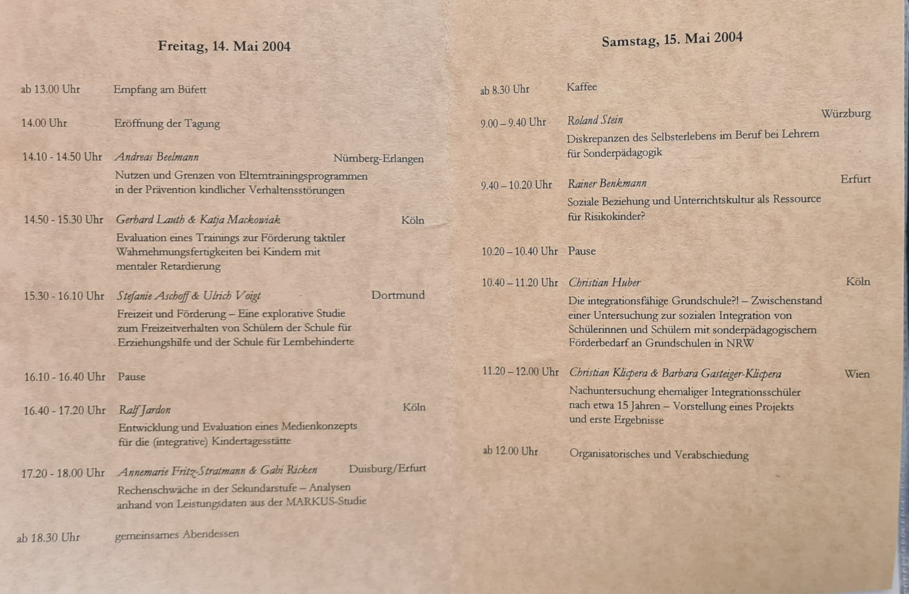
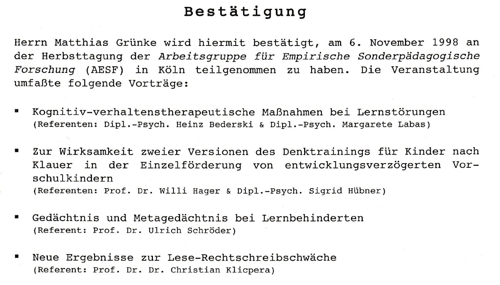

### Karl Josef Klauer (1929–2023)

Karl Josef Klauer war einer der Mitbegründer der AESF. Gabriele Ricken und Michael Grosche würdigen sein Wirken und seine Initiative zur Gründung der AESF in ihrem [Nachruf auf Karl Josef Klauer in der Zeitschrift *Empirische Sonderpädagogik* (2023, Heft 1, S. 99–100)](https://www.psychologie-aktuell.com/fileadmin/Redaktion/Journale/esp-2023-1/ESP_2023-1_99-100.pdf).

### Herbsttagung 2006 in Oldenburg

[Bericht aus dem Institut für Sonderpädagogik der Universität Oldenburg (2006), S. 22](https://uol.de/f/1/inst/sonderpaedagogik/download/Jahresbericht_2006_Druckversion.pdf)

### Frühjahrstagung 2004 in Köln

### Herbsttagung 1998 in Köln

